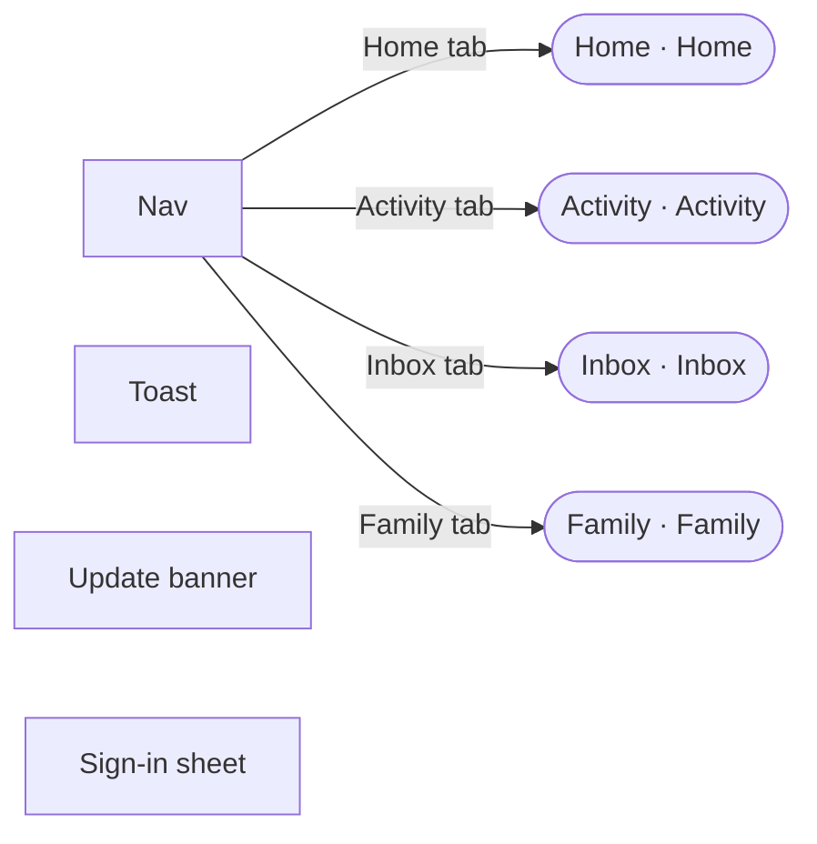
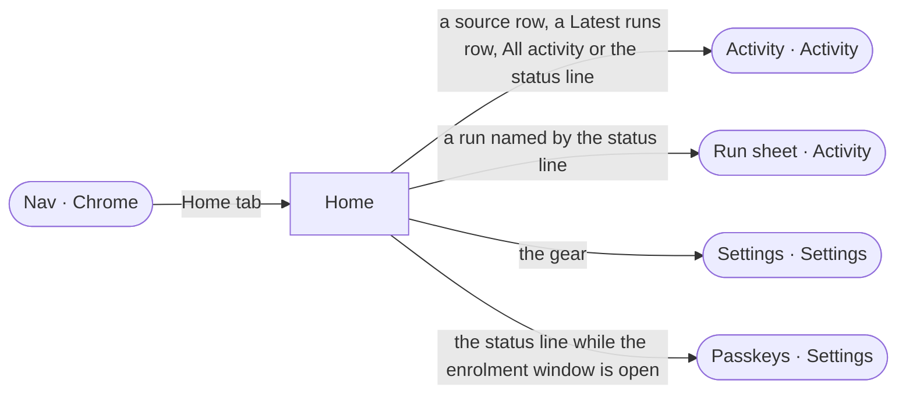
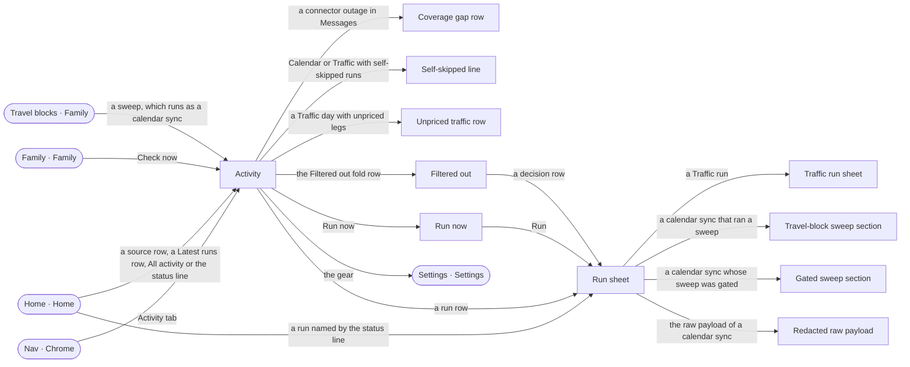
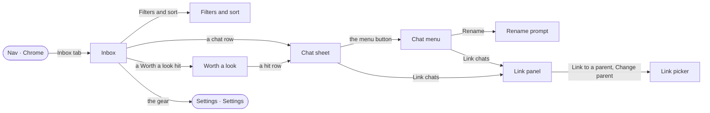
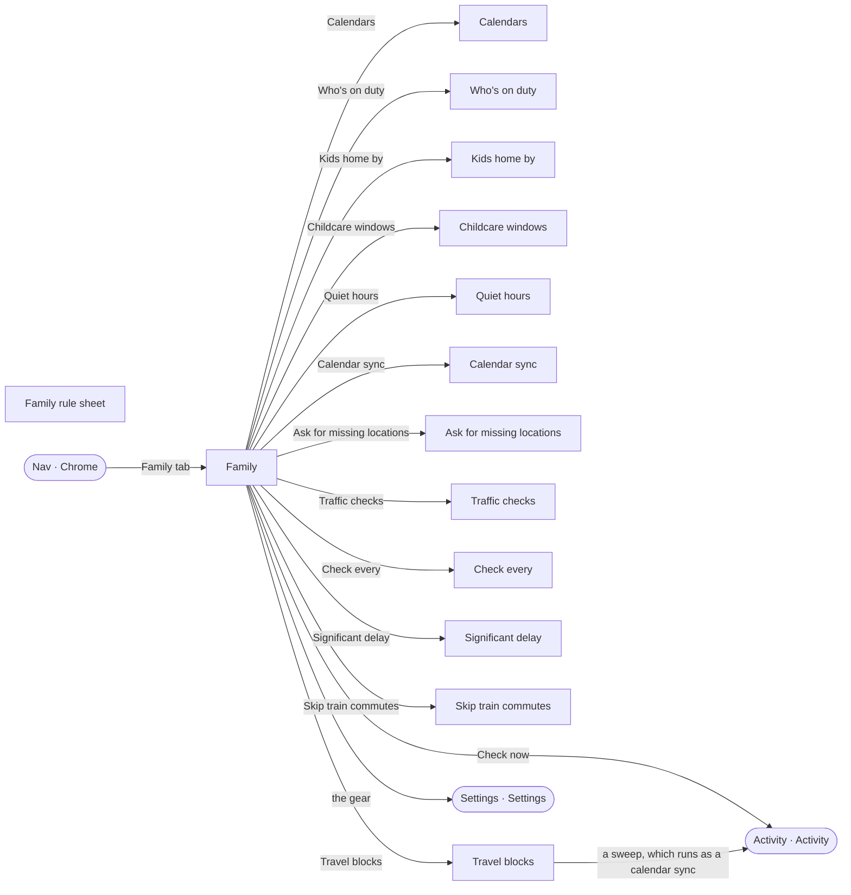
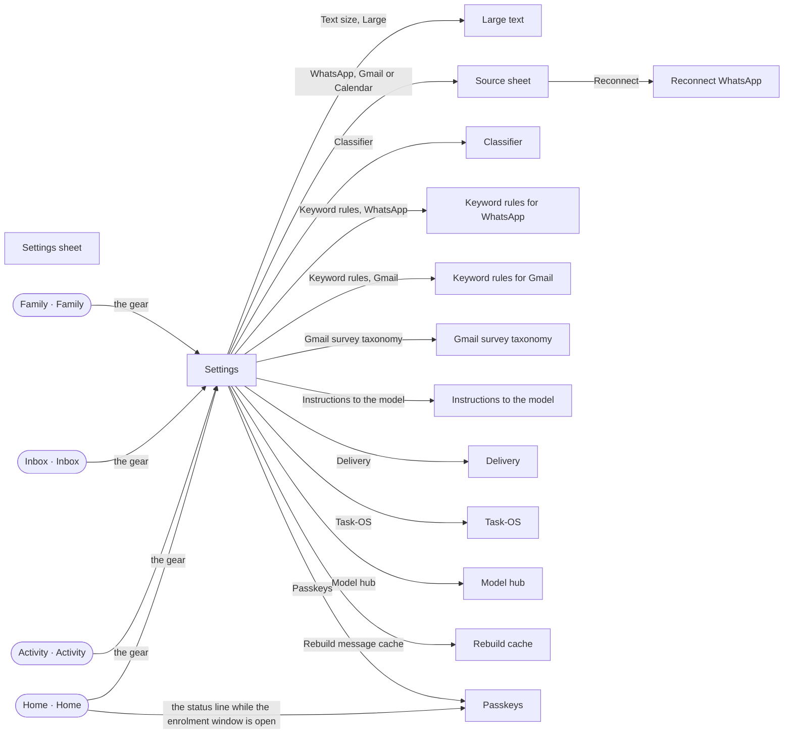
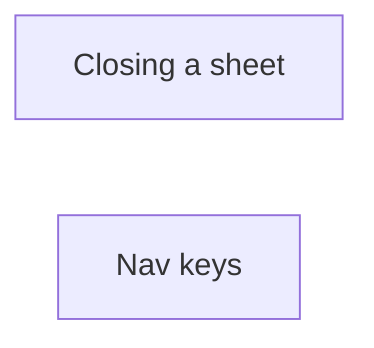

<!-- Generated from docs/ux-surfaces.yaml by scripts/ux_surface_map.py. Do not edit: change the map and re-run. -->

# UX surface map: whatsapp-radar

Every surface a person can reach in this app, each under a stable id that its root element carries as `data-surface`. Each area has a diagram of how its surfaces connect; a rounded node is a surface in another area.

The checklist of everything a person can see and do in the admin PWA: every tab, sheet, dialog, menu and Settings row, with how it is reached, what is on it and what each control does. [Webapp](webapp.md) tells the story of the tabs in prose; this page is the exhaustive index, so a layout change can check every surface and not only the ones a reviewer happens to open.

**Ids.** `<area>.<surface>`, lowercase words joined by `.` or `-`, the same form the e2e `surface(page, "<id>")` hook takes. One id names one surface even when it is drawn two ways (the run sheet is a sheet on a phone and a right-hand pane on a wide screen). The surface's root element carries the same id as `data-surface`; the vendored row menu builds its own element, so its call site stamps the id on what `attach` returns. The entries marked `none` are drawn inside another surface's root (the Settings and Family sheets share one dialog shell each) or are not elements at all, so this map and the e2e walk hold them, not the ratchet.

## Ground rules

**Four destinations, one gear.** The nav is Home · Activity · Inbox · Family. Settings is the gear in each tab's header, one tap from every tab, and is never a tab. The theme toggle sits beside it.

**Layout bands** (the same markup, three placements):

| Band | Condition | Nav | Run and chat detail |
| --- | --- | --- | --- |
| Phone | a touch pointer, up to 520px | a floating pill at the bottom, hidden under a sheet | a full-screen sheet |
| Narrow or mid window | a mouse below 1100px, or a touch device wider than 520px | a segmented bar pinned at the top | a full-screen sheet |
| Wide | 1100px and up with a mouse | a left rail | a right-hand pane beside the list |

**Sheets commit on Done.** Every edit sheet in Settings and Family holds one draft: Done saves it (a straight close when nothing changed, a toast on success, the server's message inside the sheet on a rejection), while the close button, the backdrop and Esc discard it. Text size, the theme toggle and the three switches on the Family tab apply the moment they change.

**Read-only by design.** The app ingests, classifies and notifies; nothing here sends, replies to or reacts to a WhatsApp or Gmail message.

**Where state lives.** The theme, text size and last tab live in this browser's `localStorage`; every rule, source switch and household setting lives on the server and comes back on the next load.

**Gating.** Sheets that depend on a configured service say so in place: the Delivery sheet reads the bot token as not set, Task-OS reads not configured, the Calendar sheet says nothing can be checked without a token, and the Traffic sheet warns when no Routes API key is set. Passkey enrolment opens only while the tray's enrolment window is open.

## Keyboard map

| Key | Does |
| --- | --- |
| Tab / Shift+Tab | moves between controls |
| Left / Right (Up / Down) on the nav | moves between the four tabs |
| Home / End on the nav | first and last tab |
| Esc | closes the open menu, then the open sheet, discarding its draft |
| Arrows, Home, End in a menu | moves between the items |

Walked 2026-11-18 against build `ee83c2c`, at widths 390, 1280, themes light, dark.

## Areas

| Area | Surfaces |
|---|---|
| [Chrome](#chrome) | 4 |
| [Home](#home) | 1 |
| [Activity](#activity) | 11 |
| [Inbox](#inbox) | 8 |
| [Family](#family) | 14 |
| [Settings](#settings) | 15 |
| [Keys](#keys) | 2 |

## Chrome

The nav, the toast, the sign-in sheet and the update banner, present on every tab.

### `chrome.nav` Nav

- **Root:** `data-surface`
- **Reach:** always on screen
- **Holds:** four tabs in order, Home, Activity, Inbox, Family, each a glyph and a short label
- **Does:**
  - switches the visible tab and remembers it for the next visit
  - Left, Right, Up, Down, Home and End move between the tabs
- **States:**
  - the active tab is filled
  - an open sheet hides the floating pill on a phone
- **Phone:** a floating pill at the bottom
- **Desktop:** a segmented bar pinned at the top, and a left rail from 1100px with a mouse
- **Why:** labels stay at six characters or fewer, because the floating pill gives each tab a fixed slice of a phone's width and truncates a longer one
- **Leads to:**
  - [Home](#homepane-home) (Home tab)
  - [Activity](#activitypane-activity) (Activity tab)
  - [Inbox](#inboxpane-inbox) (Inbox tab)
  - [Family](#familypane-family) (Family tab)

### `chrome.toast` Toast

- **Root:** `data-surface`
- **Reach:** appears after a save, an unlink, a copy or a failed action
- **Holds:** one line of neutral text, tinted only when it reports an error
- **Does:** disappears on its own
- **States:** error, for example a failed save or a failed link

### `app.update-banner` Update banner

- **Root:** `data-surface`
- **Reach:** appears when the server reports a newer build than the one the page loaded
- **Holds:** the line New version available and a Reload button
- **Does:** Reload loads the new build
- **Why:** the vendored build-watch component builds it, so its id is fixed in the component and every fleet app lists it

### `shared.login` Sign-in sheet

- **Root:** `data-surface`
- **Reach:** opens by itself when a request is refused for a missing or stale credential
- **Holds:** a password field and a Sign in button
- **Does:** Sign in stores the credential and reloads the data
- **States:** error, when the password is refused
- **Why:** the vendored sign-in component builds the sheet, so its id is fixed in the component and every fleet app lists it

## Home

### `home.pane` Home

- **Root:** `data-surface`
- **Reach:**
  - the Home tab
  - the first visit lands here
- **Holds:**
  - the header with the tab name, a status line, the theme toggle and the Settings gear
  - one row per source, WhatsApp, Gmail, Calendar and Traffic, with its last run and health
  - a Latest runs list and an All activity button
- **Does:**
  - the status line names the most severe exception and opens that run in Activity, or opens Passkeys while the enrolment window is open
  - a source row opens its last run in Activity
  - a Latest runs row opens that run in Activity
  - All activity switches to the Activity tab
  - the theme toggle flips light and dark
  - the gear opens Settings
- **States:**
  - loading, each source row is drawn at once with a dash so nothing shifts
  - a source offline or a failed run turns the status line red and the row's chip to Offline or Failed
  - no runs yet reads No runs yet
- **Leads to:**
  - [Activity](#activitypane-activity) (a source row, a Latest runs row, All activity or the status line)
  - [Run sheet](#activityrun-sheet-run-sheet) (a run named by the status line)
  - [Settings](#settingspage-settings) (the gear)
  - [Passkeys](#settingspasskeys-passkeys) (the status line while the enrolment window is open)

## Activity

### `activity.pane` Activity

- **Root:** `data-surface`
- **Reach:**
  - the Activity tab
  - a Home source row, the Home status line or All activity
  - a Telegram link that carries a run id
- **Holds:**
  - the header with the status line, the Run now action, the theme toggle and the gear
  - a scope switch, Messages, Calendar and Traffic
  - a filter field
  - the runs grouped by day, each row a kind glyph, a title, the time, the funnel's last numbers and exception chips
  - a Filtered out fold row at the end of Messages
  - a Load more button and a count of hidden self-skipped runs
- **Does:**
  - the scope switch changes which kind of run the list shows
  - the filter narrows the loaded runs by kind, status or time
  - a run row opens the run
  - Traffic folds each day's checks into one row, and a tap expands it
  - a coverage gap row stands for a connector outage and names its days and scans
  - Run now opens the manual run sheet
  - Load more pages in older runs
- **States:**
  - loading reads Reading runs
  - error reads Runs are unavailable. Try again.
  - empty reads No runs here yet, or No loaded runs match while a filter is typed
  - a live run is listed first under Today
- **Phone:** tapping a run opens the run sheet
- **Desktop:** tapping a run shows it in the right-hand pane and keeps the list in view
- **Leads to:**
  - [Run sheet](#activityrun-sheet-run-sheet) (a run row)
  - [Run now](#activityrun-now-run-now) (Run now)
  - [Filtered out](#activityfiltered-filtered-out) (the Filtered out fold row)
  - [Coverage gap row](#activitycoverage-gap-coverage-gap-row) (a connector outage in Messages)
  - [Self-skipped line](#activityskipped-line-self-skipped-line) (Calendar or Traffic with self-skipped runs)
  - [Unpriced traffic row](#activityunpriced-run-list-unpriced-traffic-row) (a Traffic day with unpriced legs)
  - [Settings](#settingspage-settings) (the gear)

### `activity.coverage-gap` Coverage gap row

- **Root:** none — a row of the Activity list, drawn by the list builder
- **Reach:** Messages, in place of the scans a connector outage made fail
- **Holds:**
  - the title Coverage gap, the first and last day, the number of days and failed scans, and an Offline chip
  - a tooltip with the exact times and when the connector recovered
- **Does:** stands for every failed scan of the outage, so the list reads as one event
- **States:** a gap not yet recovered says recovery not yet recorded in the tooltip

### `activity.skipped-line` Self-skipped line

- **Root:** none — one muted line under the Activity list, shown only on Calendar and Traffic
- **Reach:** Calendar or Traffic when the scope has self-skipped runs
- **Holds:** a count, such as 5 self-skipped runs hidden
- **Why:** a scheduled job skips itself between its cadence windows, so those runs are hidden from the list but stay visible in the count, per kind

### `activity.unpriced-run-list` Unpriced traffic row

- **Root:** none — a run row of the Activity list, in the Traffic scope
- **Reach:** a Traffic day expanded from its fold row
- **Holds:**
  - the priced count first, then the not priced count, never a bare checked count
  - on the day's fold row, an alert chip in the attention tone when the day had an alert
- **Why:** a count of legs checked would make a run where nothing was priced read as healthy

### `activity.run-sheet` Run sheet

- **Root:** `data-surface`
- **Reach:**
  - a run row in Activity
  - a Filtered out row
  - a Home source row, the Home status line or a Latest runs row
  - a Telegram link with a run id, which then drops the id from the address bar
- **Holds:**
  - the run's title, a meta line with status, mode, start, duration and parameters
  - the funnel, then the per-source funnel
  - one disclosure per channel with the full decision record of a message run
  - the Telegram message the run contributed
  - a Raw output disclosure, closed by default
  - a Stop this run button
- **Does:**
  - tapping the raw output copies it and shows a toast
  - Stop this run ends a live run
  - the close button, the backdrop and Esc close the sheet
- **States:**
  - a live run streams, and only then is Stop this run shown
  - a run with no per-channel record says so in place
  - a deleted run shows a toast, That run is no longer available
- **Phone:** a full-screen sheet
- **Desktop:** the same card moves into the right-hand pane of Activity
- **Why:** one detail for every kind of run, so a scan, a calendar sync and a traffic check read the same way
- **Leads to:**
  - [Traffic run sheet](#activitytraffic-run-sheet-traffic-run-sheet) (a Traffic run)
  - [Travel-block sweep section](#activitytravel-sweep-travel-block-sweep-section) (a calendar sync that ran a sweep)
  - [Gated sweep section](#activitytravel-gated-gated-sweep-section) (a calendar sync whose sweep was gated)
  - [Redacted raw payload](#activityrun-sheet-redacted-redacted-raw-payload) (the raw payload of a calendar sync)

### `activity.traffic-run-sheet` Traffic run sheet

- **Root:** none — the run sheet card, drawn for a Traffic run
- **Reach:** a run row in the Traffic scope
- **Holds:** a funnel with Priced and Not priced cells, never a Checked cell
- **Why:** the same rule as the list row, so a run where nothing was priced cannot read as a healthy count

### `activity.travel-sweep` Travel-block sweep section

- **Root:** none — a section of the run sheet card, drawn for a calendar sync that ran a sweep
- **Reach:** a calendar sync run that computed a plan
- **Holds:**
  - the sweep's outcome and counts, with Block adds in the funnel
  - the writes it made and any failures
- **Does:** the section never pushes the card sideways at phone width

### `activity.travel-gated` Gated sweep section

- **Root:** none — a section of the run sheet card, drawn for a calendar sync whose sweep never ran
- **Reach:** a calendar sync run whose sweep was disabled or lacked a key or an address
- **Holds:**
  - the line Gated, naming the gate, and the note that this is not a sweep that looked and found nothing to do
  - a single Blocks cell in the funnel, with no counts of zero
- **Why:** a sweep that never got as far as planning must not read as a sweep that planned nothing

### `activity.run-sheet-redacted` Redacted raw payload

- **Root:** none — the raw payload of a calendar sync inside the run sheet card
- **Reach:** the Raw output and the structured dump of a calendar sync run
- **Holds:**
  - the dump with each sensitive field replaced by the word withheld
  - a note saying the dump is not the whole record
- **Why:** an operator has to be able to tell the dump is redacted, so a withheld value is marked and never dropped

### `activity.run-now` Run now

- **Root:** `data-surface`
- **Reach:** the play action in the Activity header
- **Holds:**
  - four step switches, Sync messages, Process messages and email, Send alerts, and an independent Calendar sync
  - a Dry run switch
  - when Dry run is on, a window switch, New only or Last N days, and a number field for the days
  - a Run button and a busy line
- **Does:**
  - Run starts the chosen steps as one run, closes this sheet and opens the new run's sheet to follow it
  - Dry run on makes the steps plan and log without sending
- **States:** a run already in flight shows the busy line, and the steps queue behind it
- **Why:** manual runs are rare, so the controls fold behind one header action
- **Leads to:** [Run sheet](#activityrun-sheet-run-sheet) (Run)

### `activity.filtered` Filtered out

- **Root:** `data-surface`
- **Reach:** the Filtered out fold row at the end of the Messages list
- **Holds:**
  - a 7, 30 or 90 day switch
  - the recent decisions that raised no alert, each with the chat, the source, the time and a distilled reason
  - a Load more button
- **Does:** a row closes the sheet and opens the run that decided it
- **States:**
  - loading reads Reading filtered decisions
  - empty reads Nothing was filtered out in this period
  - a failed refresh keeps the list it had and marks it stale
- **Leads to:** [Run sheet](#activityrun-sheet-run-sheet) (a decision row)

## Inbox

### `inbox.pane` Inbox

- **Root:** `data-surface`
- **Reach:** the Inbox tab
- **Holds:**
  - the header with a count of monitored chats, the theme toggle and the gear
  - a name search and a Filters and sort button with a badge counting non-default values
  - the Worth a look section, only when it has hits
  - a count line while a filter narrows the list
  - one row per chat, an avatar with a source mark, the name, a preview and a watch toggle
- **Does:**
  - a row opens the chat
  - the eye on a row starts or stops monitoring that chat
  - the search narrows the list by name
  - Filters and sort opens the filter sheet
- **States:**
  - empty reads No message channels match these filters
  - the Gmail source lists senders rather than channels
- **Phone:** tapping a chat opens the chat sheet
- **Desktop:** tapping a chat shows it in the right-hand pane beside the list
- **Leads to:**
  - [Filters and sort](#inboxfilters-filters-and-sort) (Filters and sort)
  - [Chat sheet](#inboxhistory-chat-sheet) (a chat row)
  - [Worth a look](#inboxtripwire-worth-a-look) (a Worth a look hit)
  - [Settings](#settingspage-settings) (the gear)

### `inbox.tripwire` Worth a look

- **Root:** `data-surface`
- **Reach:** shown above the chat list only when a recent message in an unmonitored chat matches its source's Stage 1 rules
- **Holds:**
  - one row per chat with the signals it matched
  - an unpainted eye button
- **Does:**
  - a row opens the chat
  - the eye starts monitoring the chat
- **States:**
  - a failed check shows Could not check recent unmonitored chats
  - hidden when there is nothing to show
- **Why:** the scope of the check (Stage 1 only, the last days) sits in the section title's tooltip and in that chat's sheet, not as a permanent line
- **Leads to:** [Chat sheet](#inboxhistory-chat-sheet) (a hit row)

### `inbox.filters` Filters and sort

- **Root:** `data-surface`
- **Reach:** the Filters and sort button beside the Inbox search
- **Holds:**
  - a status switch, Monitored, Ignored and All
  - a source switch, All sources, WhatsApp and Gmail
  - Clear and Done
- **Does:**
  - each switch applies as it changes
  - Clear returns both to their defaults and is disabled while they are at the defaults
  - Done closes the sheet
- **Why:** one button holds the status and the source filter so the list keeps one search field

### `inbox.history` Chat sheet

- **Root:** `data-surface`
- **Reach:** a chat row or a Worth a look row
- **Holds:**
  - an avatar, the name, and a subtitle of source, message count, monitoring state and a Gmail sender address
  - a note when the tripwire flagged the chat, and the link panel when it is open
  - the messages, newest first, each with its time, sender and text
  - per message, Summarize, Play summary aloud, Send to Task-OS and a voice note player where they apply
  - a menu button and a close button
- **Does:**
  - scrolling to the end pages in older messages
  - Summarize asks the model for a summary and Play reads it aloud
  - Send to Task-OS hands an actionable message to Task-OS
- **States:**
  - empty reads No messages stored for this channel
  - a failed load reads Could not load history
- **Phone:** a full-screen sheet
- **Desktop:** the same card moves into the right-hand pane beside the list
- **Leads to:**
  - [Chat menu](#inboxchat-menu-chat-menu) (the menu button)
  - [Link panel](#inboxlink-panel-link-panel) (Link chats)

### `inbox.chat-menu` Chat menu

- **Root:** `data-surface`
- **Reach:** the menu button in the chat sheet's header
- **Holds:**
  - Rename
  - Link chats, with the count of linked chats, for a WhatsApp chat only
  - Monitor or Stop monitoring
- **Does:**
  - Rename asks for an alias
  - Link chats opens the link panel
  - Monitor and Stop monitoring flip the chat's status
  - Esc closes the menu and returns focus to its button
- **Why:** one labelled menu holds the rare actions so the header has two hit areas, the menu and the close
- **Leads to:**
  - [Rename prompt](#inboxrename-rename-prompt) (Rename)
  - [Link panel](#inboxlink-panel-link-panel) (Link chats)

### `inbox.rename` Rename prompt

- **Root:** none — the browser's own prompt, with no element of the app's
- **Reach:** Rename in the chat menu
- **Holds:** a text field holding the current alias
- **Does:**
  - confirming saves the alias, which shows first with the connector name in brackets
  - a blank answer clears the alias
- **States:** a failed save shows a toast, Rename failed

### `inbox.link-panel` Link panel

- **Root:** `data-surface`
- **Reach:**
  - Link chats in the chat menu
  - reopens by itself after a link or an unlink, so the result is visible
- **Holds:**
  - for a linked chat, its parent with Unlink and Change parent
  - for a parent, the linked chats, each with Unlink
  - for an unlinked chat, a hint and a Link to a parent button
- **Does:**
  - Unlink separates a chat and shows a toast
  - Link to a parent and Change parent open the picker
- **Why:** linking is local metadata only, so it is reversible and moves no message
- **Leads to:** [Link picker](#inboxlink-picker-link-picker) (Link to a parent, Change parent)

### `inbox.link-picker` Link picker

- **Root:** `data-surface`
- **Reach:** Link to a parent or Change parent in the link panel
- **Holds:**
  - a search field for a name or an alias
  - a count of candidates and the candidate chats
- **Does:** a candidate links the chat to it, closes the picker and shows a toast
- **States:**
  - empty reads No matching chats
  - a failed link shows a toast, Link failed

## Family

### `family.pane` Family

- **Root:** `data-surface`
- **Reach:** the Family tab
- **Holds:**
  - the header with a status line, the theme toggle and the gear
  - Household, with Home, Calendars and Scan window
  - Schedule, with Who's on duty, Kids home by, Childcare windows and Quiet hours
  - Calendar scan, with Calendar sync and Ask for missing locations, each with its own switch
  - Traffic checks, with the enable switch, Check every, Significant delay, Skip train commutes, Check now and Check now (dry run)
  - Travel blocks
- **Does:**
  - a row that edits something opens its sheet and shows its current value on the row
  - the three switches apply as they change
  - Check now runs the traffic check live and sends an alert if a jam is found, and Check now (dry run) sends nothing
- **States:**
  - Home and Scan window are read-only and file-provisioned
  - a missing calendar token or Routes API key is called out in the row's sheet
- **Why:** the household rules are set once and then left, so each is an inset row with its value, not a form
- **Leads to:**
  - [Calendars](#familycalendars-calendars) (Calendars)
  - [Who's on duty](#familyduty-whos-on-duty) (Who's on duty)
  - [Kids home by](#familykids-kids-home-by) (Kids home by)
  - [Childcare windows](#familywindows-childcare-windows) (Childcare windows)
  - [Quiet hours](#familyquiet-quiet-hours) (Quiet hours)
  - [Calendar sync](#familysync-calendar-sync) (Calendar sync)
  - [Ask for missing locations](#familyask-ask-for-missing-locations) (Ask for missing locations)
  - [Traffic checks](#familytraffic-traffic-checks) (Traffic checks)
  - [Check every](#familycadence-check-every) (Check every)
  - [Significant delay](#familydelay-significant-delay) (Significant delay)
  - [Skip train commutes](#familytrain-skip-train-commutes) (Skip train commutes)
  - [Travel blocks](#familytravel-travel-blocks) (Travel blocks)
  - [Activity](#activitypane-activity) (Check now)
  - [Settings](#settingspage-settings) (the gear)

### `family.sheet` Family rule sheet

- **Root:** `data-surface`
- **Reach:** any Family row except Travel blocks
- **Holds:** a title, one line of help, the rule's controls, a Where this lives line and the Done button
- **Does:**
  - Done saves the draft, closes the sheet and shows a toast
  - the close button, the backdrop and Esc discard the draft
- **States:** a rejected value shows the server's message inside the sheet
- **Why:** one shell is filled per rule, so every rule edits and commits the same way

### `family.calendars` Calendars

- **Root:** none — drawn inside the Family rule sheet
- **Reach:** the Calendars row
- **Holds:** the household calendars the daily scan reads, and the Calendar token state
- **States:**
  - empty reads No household calendars configured yet
  - a missing token reads No Calendar token, nothing can be checked
- **Why:** read-only, because the calendars and the token are provisioned in files

### `family.duty` Who's on duty

- **Root:** none — drawn inside the Family rule sheet
- **Reach:** the Who's on duty row
- **Holds:** one person picker per weekday
- **Does:** Done saves the week

### `family.kids` Kids home by

- **Root:** none — drawn inside the Family rule sheet
- **Reach:** the Kids home by row
- **Holds:** a time field
- **Does:** Done saves the time

### `family.windows` Childcare windows

- **Root:** none — drawn inside the Family rule sheet
- **Reach:** the Childcare windows row
- **Holds:**
  - one block per window with a label, its days, a start and an end time
  - an add button and a remove button per window
- **Does:** the plus Add childcare window button adds a block, the remove button on a block drops it, and Done saves the list

### `family.quiet` Quiet hours

- **Root:** none — drawn inside the Family rule sheet
- **Reach:** the Quiet hours row
- **Holds:** From and Until hour fields
- **Does:** no traffic alert is sent between the two hours

### `family.sync` Calendar sync

- **Root:** none — drawn inside the Family rule sheet
- **Reach:** the Calendar sync row
- **Holds:** a Calendar sync switch
- **Does:** turns the daily calendar scan on or off
- **Why:** the row's own switch applies at once, and the sheet carries the same switch with its help

### `family.ask` Ask for missing locations

- **Root:** none — drawn inside the Family rule sheet
- **Reach:** the Ask for missing locations row
- **Holds:** a switch
- **Does:** off hides the No location set list from the summary, and those events are still assumed home and recorded in Activity

### `family.traffic` Traffic checks

- **Root:** none — drawn inside the Family rule sheet
- **Reach:** the Traffic checks row
- **Holds:** a Traffic checks switch
- **Does:** turns the live traffic checks on or off, while the schedule itself is an App Launcher job
- **States:** a missing Routes API key shows a warning that checks will error

### `family.cadence` Check every

- **Root:** none — drawn inside the Family rule sheet
- **Reach:** the Check every row
- **Holds:** a field for the minutes between checks, 5 to 240
- **Does:** the job fires often and skips itself against this cadence, so a change needs no re-arm

### `family.delay` Significant delay

- **Root:** none — drawn inside the Family rule sheet
- **Reach:** the Significant delay row
- **Holds:** a field for the minutes, 0 to 240
- **Does:** a traffic alert is sent only when a jam adds more than this

### `family.train` Skip train commutes

- **Root:** none — drawn inside the Family rule sheet
- **Reach:** the Skip train commutes row
- **Holds:** a switch and the keywords a title is matched against, read-only
- **Does:** the leave-now alert is a driving judgment, so it is skipped for a commute whose title names a train

### `family.travel` Travel blocks

- **Root:** `data-surface`
- **Reach:** the Travel blocks row
- **Holds:**
  - a mode banner naming live, dry run or off
  - a Write travel blocks switch and a Dry run switch
  - fields for the minimum home dwell and the block title
  - the calendar capability list, each calendar Writable, Not writable or Unknown
  - the last sweep, with its time, outcome and counts
  - Rehearse (dry run) and Run sweep
- **Does:**
  - Rehearse fires the calendar sync forced to plan only
  - Run sweep fires it live
  - Done saves the settings, while the sweep controls act at once and are not part of the draft
- **States:**
  - a sweep that never got as far as planning says so in words and shows no counts
  - an unresolved calendar probe is Unknown, with its own glyph and a dashed border, never a tick or a cross
  - Run sweep is disabled, with the reason, while a live sweep is blocked
  - no write token shows a warning that nothing can be written
- **Why:** Unknown is its own state because a probe that did not resolve is not a pass
- **Leads to:** [Activity](#activitypane-activity) (a sweep, which runs as a calendar sync)

## Settings

### `settings.page` Settings

- **Root:** `data-surface`
- **Reach:** the gear in any tab's header
- **Holds:**
  - Display, with a Text size switch, Small, Default and Large
  - Sources, with WhatsApp, Gmail and Calendar
  - How messages are judged, with Classifier, the two Keyword rules rows, Gmail survey taxonomy and Instructions to the model
  - Alerts, with Delivery, Task-OS and Model hub
  - Maintenance, with Rebuild message cache
  - This install, with Passkeys and Build
- **Does:**
  - a row shows its current value and opens its sheet
  - Text size applies at once
  - the close button and Esc return to the tab underneath
- **States:** a value that needs attention, such as Bot token not set or Not configured, is marked in the row
- **Phone:** a full-screen page
- **Desktop:** the same full page over the tab
- **Why:** Settings is a full page over the current tab, never a tab of its own
- **Leads to:**
  - [Large text](#settingstext-size-large-large-text) (Text size, Large)
  - [Source sheet](#settingssource-sheet-source-sheet) (WhatsApp, Gmail or Calendar)
  - [Classifier](#settingsclassifier-classifier) (Classifier)
  - [Keyword rules for WhatsApp](#settingsrules-whatsapp-keyword-rules-for-whatsapp) (Keyword rules, WhatsApp)
  - [Keyword rules for Gmail](#settingsrules-gmail-keyword-rules-for-gmail) (Keyword rules, Gmail)
  - [Gmail survey taxonomy](#settingstaxonomy-gmail-survey-taxonomy) (Gmail survey taxonomy)
  - [Instructions to the model](#settingsinstructions-instructions-to-the-model) (Instructions to the model)
  - [Delivery](#settingsdelivery-delivery) (Delivery)
  - [Task-OS](#settingstask-os-task-os) (Task-OS)
  - [Model hub](#settingshub-model-hub) (Model hub)
  - [Rebuild cache](#settingsrebuild-rebuild-cache) (Rebuild message cache)
  - [Passkeys](#settingspasskeys-passkeys) (Passkeys)

### `settings.text-size-large` Large text

- **Root:** none — the whole app redrawn at the Large step, with no element of its own
- **Reach:** Text size, Large, in Settings
- **Holds:** every label grows a step and the segmented track keeps its height
- **Why:** the track is a fixed control height, so the Large step grows its labels and never the track

### `settings.sheet` Settings sheet

- **Root:** `data-surface`
- **Reach:** any Settings row except the three sources
- **Holds:** a title, one line of help, the row's controls, a Where this lives line and the Done button
- **Does:**
  - Done saves a partial change and shows a toast, or runs the action of a confirm sheet
  - the close button, the backdrop and Esc discard the draft
- **States:**
  - a rejected value shows the server's message inside the sheet
  - a read-only sheet has no footer
- **Why:** one shell is filled per row, so every row edits and commits the same way

### `settings.source-sheet` Source sheet

- **Root:** `data-surface`
- **Reach:** the WhatsApp, Gmail or Calendar row
- **Holds:**
  - for WhatsApp and Gmail, an Enabled switch, and for WhatsApp a Connector picker
  - the stored counts, the source's health and its recent syncs
  - for WhatsApp, the Reconnect block
- **Does:**
  - Done saves the switch and the connector
  - the health and the syncs refresh in place while the sheet is open
- **States:**
  - Calendar has nothing to edit, because the daily scan is switched on in Family
  - no syncs yet reads No syncs yet, run Sync to pull new messages
- **Why:** read-only by design, so the sheet states that messages are ingested and judged, never sent
- **Leads to:** [Reconnect WhatsApp](#settingsreconnect-reconnect-whatsapp) (Reconnect)

### `settings.reconnect` Reconnect WhatsApp

- **Root:** none — a block inside the WhatsApp source sheet, shown only when the connector is not linked
- **Reach:** the WhatsApp source sheet while the sidecar is disconnected or needs a pairing code
- **Holds:** a message saying why, the pairing QR code, and one button
- **Does:**
  - the button starts the WhatsApp sidecar and shows a toast, and its label reads Reconnect WhatsApp, Start and show QR or Refresh QR by state
  - when a pairing code is needed the block tells the person to open Linked devices in WhatsApp and scan it, and the code refreshes about every twenty seconds
- **States:**
  - hidden while the connector is healthy
  - the button is disabled while a link is in progress

### `settings.classifier` Classifier

- **Root:** none — drawn inside the Settings sheet
- **Reach:** the Classifier row
- **Holds:** a Classifier picker
- **Does:** Done saves how a new message is judged before anything is sent

### `settings.rules-whatsapp` Keyword rules for WhatsApp

- **Root:** none — drawn inside the Settings sheet
- **Reach:** the Keyword rules, WhatsApp row
- **Holds:** the keyword pass a WhatsApp message must clear before the model sees it, read-only, and the file it lives in
- **Why:** read-only, because the rules are edited in the file

### `settings.rules-gmail` Keyword rules for Gmail

- **Root:** none — drawn inside the Settings sheet
- **Reach:** the Keyword rules, Gmail row
- **Holds:** the bucket and keyword pass a Gmail message must clear, read-only, and the Gmail whitelist of senders and labels
- **States:** an empty whitelist reads empty

### `settings.taxonomy` Gmail survey taxonomy

- **Root:** none — drawn inside the Settings sheet
- **Reach:** the Gmail survey taxonomy row
- **Holds:** a reference for writing the Gmail keyword rules, read-only
- **Why:** it is never sent to the model

### `settings.instructions` Instructions to the model

- **Root:** none — drawn inside the Settings sheet
- **Reach:** the Instructions to the model row
- **Holds:** the system prompt both sources share, read-only
- **Does:** Activity shows the exact prompt for every call

### `settings.delivery` Delivery

- **Root:** none — drawn inside the Settings sheet
- **Reach:** the Delivery row
- **Holds:** a Notifier picker, a Telegram chat ID field, the bot token state and a New bot token field
- **Does:** a typed token is sent, and a blank one keeps the stored token
- **States:** the row reads Bot token not set while Telegram is chosen without a token

### `settings.task-os` Task-OS

- **Root:** none — drawn inside the Settings sheet
- **Reach:** the Task-OS row
- **Holds:** a Send automatically switch and an Export line
- **Does:** on sends actionable messages to the Task-OS Inbox after each run, and off waits for Send to Task-OS in the chat
- **States:** the row reads Not configured when automatic export lacks a token

### `settings.hub` Model hub

- **Root:** none — drawn inside the Settings sheet
- **Reach:** the Model hub row
- **Holds:** a Base URL field and a Model field
- **Does:** Done saves the hub the classifier calls

### `settings.rebuild` Rebuild cache

- **Root:** none — drawn inside the Settings sheet
- **Reach:** the Rebuild message cache row
- **Holds:**
  - what is preserved, what is backed up first and what is reset
  - a red Rebuild cache button in place of Done
- **Does:** the button rebuilds the local store from the connector buffer, and Close cancels
- **Why:** a destructive action is a confirm sheet, never a switch

### `settings.passkeys` Passkeys

- **Root:** none — drawn inside the Settings sheet
- **Reach:**
  - the Passkeys row
  - the Home status line while the enrolment window is open
- **Holds:**
  - the enrolled devices, each with a remove button
  - while enrolment is open, a Device name field and an Enroll this device button
- **Does:**
  - remove turns the row into a Remove question with Cancel and Remove, inside the same row
  - Enroll this device registers this browser
- **States:**
  - enrolment closed reads that it opens from the tray menu on the PC, for a few minutes at a time
  - a browser without passkey support shows a toast saying so

## Keys

### `keys.dialogs` Closing a sheet

- **Root:** none — a behaviour of every sheet, with no element of its own
- **Holds:** Esc, a tap on the backdrop and the close button all close the open sheet
- **Does:** each of them discards an unsaved draft, and only Done saves

### `keys.nav` Nav keys

- **Root:** none — keys on the nav, with no element of their own
- **Holds:** Left, Right, Up and Down move between the tabs, and Home and End jump to the first and last

## Link index

| From | Via | To |
|---|---|---|
| [Nav](#chromenav-nav) | Home tab | [Home](#homepane-home) |
| [Nav](#chromenav-nav) | Activity tab | [Activity](#activitypane-activity) |
| [Nav](#chromenav-nav) | Inbox tab | [Inbox](#inboxpane-inbox) |
| [Nav](#chromenav-nav) | Family tab | [Family](#familypane-family) |
| [Home](#homepane-home) | a source row, a Latest runs row, All activity or the status line | [Activity](#activitypane-activity) |
| [Home](#homepane-home) | a run named by the status line | [Run sheet](#activityrun-sheet-run-sheet) |
| [Home](#homepane-home) | the gear | [Settings](#settingspage-settings) |
| [Home](#homepane-home) | the status line while the enrolment window is open | [Passkeys](#settingspasskeys-passkeys) |
| [Activity](#activitypane-activity) | a run row | [Run sheet](#activityrun-sheet-run-sheet) |
| [Activity](#activitypane-activity) | Run now | [Run now](#activityrun-now-run-now) |
| [Activity](#activitypane-activity) | the Filtered out fold row | [Filtered out](#activityfiltered-filtered-out) |
| [Activity](#activitypane-activity) | a connector outage in Messages | [Coverage gap row](#activitycoverage-gap-coverage-gap-row) |
| [Activity](#activitypane-activity) | Calendar or Traffic with self-skipped runs | [Self-skipped line](#activityskipped-line-self-skipped-line) |
| [Activity](#activitypane-activity) | a Traffic day with unpriced legs | [Unpriced traffic row](#activityunpriced-run-list-unpriced-traffic-row) |
| [Activity](#activitypane-activity) | the gear | [Settings](#settingspage-settings) |
| [Run sheet](#activityrun-sheet-run-sheet) | a Traffic run | [Traffic run sheet](#activitytraffic-run-sheet-traffic-run-sheet) |
| [Run sheet](#activityrun-sheet-run-sheet) | a calendar sync that ran a sweep | [Travel-block sweep section](#activitytravel-sweep-travel-block-sweep-section) |
| [Run sheet](#activityrun-sheet-run-sheet) | a calendar sync whose sweep was gated | [Gated sweep section](#activitytravel-gated-gated-sweep-section) |
| [Run sheet](#activityrun-sheet-run-sheet) | the raw payload of a calendar sync | [Redacted raw payload](#activityrun-sheet-redacted-redacted-raw-payload) |
| [Run now](#activityrun-now-run-now) | Run | [Run sheet](#activityrun-sheet-run-sheet) |
| [Filtered out](#activityfiltered-filtered-out) | a decision row | [Run sheet](#activityrun-sheet-run-sheet) |
| [Inbox](#inboxpane-inbox) | Filters and sort | [Filters and sort](#inboxfilters-filters-and-sort) |
| [Inbox](#inboxpane-inbox) | a chat row | [Chat sheet](#inboxhistory-chat-sheet) |
| [Inbox](#inboxpane-inbox) | a Worth a look hit | [Worth a look](#inboxtripwire-worth-a-look) |
| [Inbox](#inboxpane-inbox) | the gear | [Settings](#settingspage-settings) |
| [Worth a look](#inboxtripwire-worth-a-look) | a hit row | [Chat sheet](#inboxhistory-chat-sheet) |
| [Chat sheet](#inboxhistory-chat-sheet) | the menu button | [Chat menu](#inboxchat-menu-chat-menu) |
| [Chat sheet](#inboxhistory-chat-sheet) | Link chats | [Link panel](#inboxlink-panel-link-panel) |
| [Chat menu](#inboxchat-menu-chat-menu) | Rename | [Rename prompt](#inboxrename-rename-prompt) |
| [Chat menu](#inboxchat-menu-chat-menu) | Link chats | [Link panel](#inboxlink-panel-link-panel) |
| [Link panel](#inboxlink-panel-link-panel) | Link to a parent, Change parent | [Link picker](#inboxlink-picker-link-picker) |
| [Family](#familypane-family) | Calendars | [Calendars](#familycalendars-calendars) |
| [Family](#familypane-family) | Who's on duty | [Who's on duty](#familyduty-whos-on-duty) |
| [Family](#familypane-family) | Kids home by | [Kids home by](#familykids-kids-home-by) |
| [Family](#familypane-family) | Childcare windows | [Childcare windows](#familywindows-childcare-windows) |
| [Family](#familypane-family) | Quiet hours | [Quiet hours](#familyquiet-quiet-hours) |
| [Family](#familypane-family) | Calendar sync | [Calendar sync](#familysync-calendar-sync) |
| [Family](#familypane-family) | Ask for missing locations | [Ask for missing locations](#familyask-ask-for-missing-locations) |
| [Family](#familypane-family) | Traffic checks | [Traffic checks](#familytraffic-traffic-checks) |
| [Family](#familypane-family) | Check every | [Check every](#familycadence-check-every) |
| [Family](#familypane-family) | Significant delay | [Significant delay](#familydelay-significant-delay) |
| [Family](#familypane-family) | Skip train commutes | [Skip train commutes](#familytrain-skip-train-commutes) |
| [Family](#familypane-family) | Travel blocks | [Travel blocks](#familytravel-travel-blocks) |
| [Family](#familypane-family) | Check now | [Activity](#activitypane-activity) |
| [Family](#familypane-family) | the gear | [Settings](#settingspage-settings) |
| [Travel blocks](#familytravel-travel-blocks) | a sweep, which runs as a calendar sync | [Activity](#activitypane-activity) |
| [Settings](#settingspage-settings) | Text size, Large | [Large text](#settingstext-size-large-large-text) |
| [Settings](#settingspage-settings) | WhatsApp, Gmail or Calendar | [Source sheet](#settingssource-sheet-source-sheet) |
| [Settings](#settingspage-settings) | Classifier | [Classifier](#settingsclassifier-classifier) |
| [Settings](#settingspage-settings) | Keyword rules, WhatsApp | [Keyword rules for WhatsApp](#settingsrules-whatsapp-keyword-rules-for-whatsapp) |
| [Settings](#settingspage-settings) | Keyword rules, Gmail | [Keyword rules for Gmail](#settingsrules-gmail-keyword-rules-for-gmail) |
| [Settings](#settingspage-settings) | Gmail survey taxonomy | [Gmail survey taxonomy](#settingstaxonomy-gmail-survey-taxonomy) |
| [Settings](#settingspage-settings) | Instructions to the model | [Instructions to the model](#settingsinstructions-instructions-to-the-model) |
| [Settings](#settingspage-settings) | Delivery | [Delivery](#settingsdelivery-delivery) |
| [Settings](#settingspage-settings) | Task-OS | [Task-OS](#settingstask-os-task-os) |
| [Settings](#settingspage-settings) | Model hub | [Model hub](#settingshub-model-hub) |
| [Settings](#settingspage-settings) | Rebuild message cache | [Rebuild cache](#settingsrebuild-rebuild-cache) |
| [Settings](#settingspage-settings) | Passkeys | [Passkeys](#settingspasskeys-passkeys) |
| [Source sheet](#settingssource-sheet-source-sheet) | Reconnect | [Reconnect WhatsApp](#settingsreconnect-reconnect-whatsapp) |
